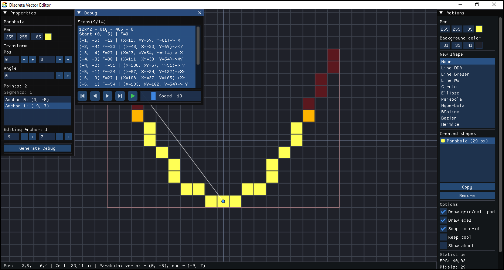

# Discrete Vector Editor

A lightweight 2D drawing tool and rasterization sandbox with step-by-step execution. Shapes are stored as editable vector primitives and projected onto a pixel grid using custom drawing algorithms. 

### [Try it now!](https://Pavel314.github.io/vector_ed)

## Toolchain

- **C# 14** (with Native AOT and WebAssembly)
- **[Sokol](https://github.com/floooh/sokol)**
- **[Dear ImGui](https://github.com/ocornut/imgui)**

_Both Sokol and Dear ImGui are provided via the [Sokol.NET](https://github.com/elix22/Sokol.NET) bindings._

## Primitives

- **Lines**: DDA, Bresenham, and Wu's anti-aliased line algorithms
- **Conics**: Universal integer incremental rasterizer for conic equations, including circles, ellipses, parabolas, and hyperbolas
- **Curves**: General parametric rasterizer, with cubic splines (Bézier, Hermite, and B-spline)

## Features

- **Step-by-Step Debugger**: Inspect algorithm execution pixel-by-pixel with playback controls
- **Interactive Editing**: Drag control points, apply 2D transforms (position & rotation), and snap to grid
- **Camera**: `Right-Click Drag` to pan, `Scroll` to zoom, `R` to reset camera
- **Pen Mode**: Hold Left `Ctrl` + `Left-Click` to append control points to splines; press `Delete` to remove

## Screenshots

